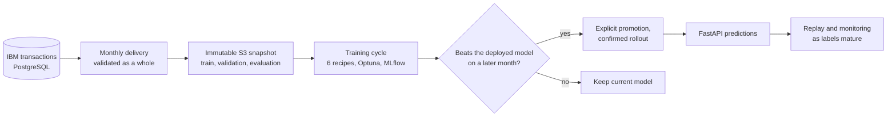
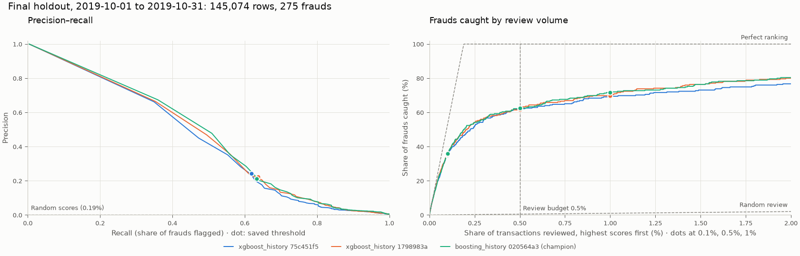

# Fraud Risk Platform

A fraud-detection platform covering data validation, model training, evaluation, controlled releases and monitoring. It replays IBM's 24.4 million synthetic card transactions as monthly deliveries, validates each into an immutable snapshot, trains and compares six models, and replaces the deployed model only when a challenger beats it on a later month. Everything runs locally with Docker Compose; the AWS deployment is defined in Terraform.



## What it demonstrates

- **No leakage by construction.** Fraud labels arrive 7 days after each transaction. Snapshots hide unreleased labels, card-history features count a fraud only once it was released, and tests check that training and serving compute identical features.
- **Trustworthy data.** A monthly delivery is accepted or rejected as a whole, and rejected data is kept as evidence. Snapshots are content-addressed Parquet files with a manifest written last and verified before training. Retries never duplicate or skip a month.
- **Honest model selection.** Thresholds and winners are chosen on validation data only. The frozen winner then faces the deployed model on the following month and must catch 2 percentage points more fraud at a 0.5% review budget. October 2019 is held out from every cycle and scored once.
- **Safe deployment.** Releases are self-verifying bundles, and promotion is an explicit command. A rollout counts only once the running API serves the new release; otherwise the last good release is restored. Rollback is one command.
- **Operations.** A PostgreSQL job ledger deduplicates and retries training. Each month's traffic is scored by the deployed model before its outcomes exist, then monitored as labels mature. Prometheus and Grafana track the API.
- **Cloud definition.** Terraform defines ECS, RDS, EFS, and a Step Functions workflow that trains on SageMaker, tested offline with mocked providers, tflint, and checkov.

## Results

The final run covered July to November 2019: an initial training cycle, three monthly updates, and the reserved holdout month. Each cycle trained on a one-million-row sample.

| Cutoff | Winner | Evaluation month | Recall at 0.5%: challenger vs incumbent | Decision | Report |
| --- | --- | --- | --- | --- | --- |
| 2019-07-08 | XGBoost | June | 52.6% | Initial promotion | [cycle](https://rafjasn.github.io/fraud-risk-platform/reports/training/cycle-2019-07-08/report.html) |
| 2019-08-08 | XGBoost | July | 66.2% vs 63.6% | Promote | [cycle](https://rafjasn.github.io/fraud-risk-platform/reports/training/cycle-2019-08-08/report.html) |
| 2019-09-08 | Histogram boosting | August | 60.0% vs 57.0% | Promote | [cycle](https://rafjasn.github.io/fraud-risk-platform/reports/training/cycle-2019-09-08/report.html) |
| 2019-10-08 | XGBoost | September | 61.3% vs 60.6% | Keep current | [cycle](https://rafjasn.github.io/fraud-risk-platform/reports/training/cycle-2019-10-08/report.html) |

On October 2019 (145,074 transactions, 275 frauds), the final model caught 62.5% of frauds (95% interval 57.3–67.8%) and the first model 62.2%: the monthly updates did not measurably improve on it. While deployed, the models caught 58–63% of each month's fraud.



Reports: [holdout evaluation](https://rafjasn.github.io/fraud-risk-platform/reports/final-evaluation/report.html) · [monitoring of deployed models](https://rafjasn.github.io/fraud-risk-platform/reports/monitoring/2019-11-08/report.html) · [initial data snapshot](https://rafjasn.github.io/fraud-risk-platform/reports/data/snapshot-2019-07-08.html) · [all reports](https://rafjasn.github.io/fraud-risk-platform/reports/) · [full results and evaluation context](docs/RESULTS.md#final-experiment).

## Run it

You need Docker with Compose v2, Make, about 8 GB of memory, and about 20 GB of free disk; the PostgreSQL volume alone takes about 15 GB. The final run used an 8 GB Mac. No AWS or LocalStack account is needed.

```sh
make setup              # build the images
make up                 # start PostgreSQL, LocalStack S3, MLflow, the API, Prometheus, Grafana
make seed-source        # download, verify, and load the IBM transactions (once)
make initial-snapshot   # the first monthly snapshot, cutoff 2019-07-08
make month              # train the initial cycle; it prints the promote command
make promote RELEASE=<release-id> INITIAL=--initial
make month              # each further month: replay, snapshot, monitor, train
make final-evaluation   # once a month reports holdout_reached
```

Promote whenever `make month` recommends it; otherwise continue with `make month SKIP_PROMOTION=1`. The API is at http://127.0.0.1:8000/docs, MLflow at http://127.0.0.1:5001, and Grafana at http://127.0.0.1:3000. `make test` runs the tests in containers. [OPERATIONS.md](docs/OPERATIONS.md) covers every command, fault-injection exercises, database access, and resets.

To run it on Kubernetes instead, the [Helm chart](charts/fraud-risk-platform/README.md) installs the same images on a local kind cluster, runs every command as a Job, and promotes models with a rolling update that a failing model cannot pass.

**Stack:** Python 3.14, PostgreSQL 17, DuckDB, LocalStack S3, MLflow, scikit-learn, XGBoost, PyTorch served as ONNX, Optuna, FastAPI, Prometheus, Grafana, Docker Compose, Kubernetes with Helm, Terraform.

## Verification and limits

- 274 tests, 52 of them against real PostgreSQL and LocalStack, plus 20 Terraform tests with mocked AWS providers. The GitHub Actions workflow runs them with image builds.
- The transactions are synthetic and the label delay is simulated, so the results say nothing about real-world fraud.
- Latency and throughput were measured on one laptop, not production hardware.

## Documentation

| Document | Contents |
| --- | --- |
| [RESULTS.md](docs/RESULTS.md) | Final experiment, evaluation context, report artifacts, and development findings |
| [MODEL_CARD.md](docs/MODEL_CARD.md) | Intended use, data, and limitations of the models |
| [ARCHITECTURE.md](docs/ARCHITECTURE.md) | Packages, boundaries, key decisions, and a guided code walkthrough |
| [OPERATIONS.md](docs/OPERATIONS.md) | Every command, configuration options, recovery |
| [DATA.md](docs/DATA.md) | Source provenance, seeding, monthly deliveries, validation, snapshots, data reports |
| [TRAINING.md](docs/TRAINING.md) | Features, recipes, selection, the promotion gate, training jobs, SageMaker |
| [MONITORING.md](docs/MONITORING.md) | Replay, monitoring, the final holdout, API metrics |
| [infra/terraform](infra/terraform/README.md) | The AWS deployment and its verification |
| [charts/fraud-risk-platform](charts/fraud-risk-platform/README.md) | The Helm chart for running the platform on Kubernetes |

The data is IBM's synthetic credit-card transaction set from [TabFormer](https://github.com/IBM/TabFormer) ([license](https://github.com/IBM/TabFormer/blob/ebb7cd68ee1897599568107740bc452104bbbaf8/LICENSE)). It is downloaded and checksum-verified during setup and is not stored in this repository. The code is licensed under the [Apache License 2.0](LICENSE).
