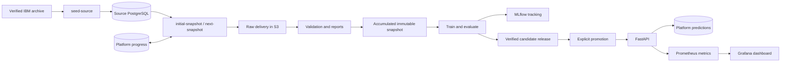

# Architecture

The application supports one source: IBM synthetic credit-card transactions. The CLI dispatches finite jobs, while Uvicorn runs `fraud_risk_platform.serving.app:app`.

## Responsibilities

| Package/module | Owns |
| --- | --- |
| `seeding/ibm.py` | Download/checksum verification, typed CSV parsing, resumable bulk loading |
| `dataops/workflow.py` | Initial/next commands, automatic source selection, persisted monthly progress and exhaustion |
| `dataops/ingestion.py` | As-of extraction, raw evidence, acceptance, S3 publication |
| `dataops/history_store.py` | DuckDB-backed history, delivery validation, duplicates/conflicts, deterministic row selection |
| `dataops/dataset.py` | IBM observation schema and internal data settings |
| `dataops/reader.py` | Snapshot discovery, integrity/semantic checks, bounded reads |
| `dataops/reports/` | Data-quality summaries and visual delivery/snapshot reports |
| `features/` | Shared transaction and card-history features; feature matrices from snapshots |
| `training/` | Fit/select/evaluate models, enforce training suitability, log MLflow evidence, deduplicate and retry training jobs |
| `evaluation/` | Threshold selection, metrics, the acceptance gate, and charts for training and monitoring |
| `models/` | Model recipes, serialization, compatibility, promotion, rollback |
| `serving/` | Prediction endpoints, loaded model, pooled database connections, durable prediction records, Prometheus metrics |
| `monitoring/` | Monthly replay of traffic through the deployed release, delayed-outcome joins, mature-outcome reports, API load tests, and the one-time final holdout evaluation (`holdout.py`) |
| `persistence/` | PostgreSQL schemas/connections, S3 operations, hashes and files |
| `reporting/` | The look of every report: colors by role (`palette.py`, the only module that defines a color), matplotlib chart styling (`style.py`), and the HTML page layout (`page.py`). Standard library, matplotlib, and numpy only, so the ingestion image renders data reports like the others |
| `contracts/` | Dependency-free contracts: feature sets (`features.py`), training policy and recipes (`training.py`), API schemas (`api.py`) |

Configuration lives in `config/data.json`, `config/training.json`, and the pinned source manifest `config/ibm-tabformer.lock.json`. Commands need no dataset or import identifiers; those stay internal, in manifests and ledgers.

## Boundaries

- **Databases.** One PostgreSQL server holds three databases with separate owners: `fraud_source` (the IBM import, read by snapshot jobs and the API through the read-only `source_reader` role), `fraud_platform` (the simulation clock, ledgers, predictions, and replays), and `mlflow`.
- **Time.** Only the monthly extraction reads the source table for training data. Training reads verified snapshots and never the source. The API reads one card's past and replay one month's, with labels masked at each transaction's time.
- **Images.** The ingestion image has no model libraries or MLflow, the training image has every model family, and the API image serves every model type without PyTorch. They share one lockfile, so overlapping packages have the same versions.
- **Identity.** A transaction is its import ID plus its CSV row number. The API's `transaction_id` is that row number, and every release and prediction records the import, so outcome joins cannot mix sources.
- **Integrity versus suitability.** A snapshot can be valid data and still unsuitable for training. Ingestion publishes it; training refuses it and says why.
- **Shared state.** Releases, `deployment.json`, and reports are files in the state directory, mounted read-only into the API. On AWS the same directory is an EFS access point.

## Extending it

- **A feature:** add its calculation to `features/transaction.py` or `features/history.py`, and its name to `contracts/features.py`. Training and serving share the calculation, and each release stores the feature definition it was trained with.
- **A scikit-learn-compatible estimator:** add a builder to `BUILDERS` in `models/recipes.py`; the joblib adapter saves and scores it.
- **Another framework:** implement the four-method adapter in `models/adapters.py` (`fit`, `scores`, `save`, `load`, plus the files it writes), as `models/neural.py` does for PyTorch with ONNX.
- **Another orchestrator:** commands started with `STEP_FUNCTIONS_TASK_TOKEN` return their result to Step Functions, `month --stop-before-training` hands training elsewhere, and `training/entrypoint.py` runs a cycle under SageMaker's container contract. [infra/terraform](../infra/terraform/README.md) uses all three.

## Key decisions

| Topic | Decision |
| --- | --- |
| Dataset | IBM's synthetic credit-card transactions distributed with TabFormer: 24.4 million transactions with fraud labels and card identities. The TabFormer model itself is not used. |
| Upstream source | The corpus is bulk-loaded into PostgreSQL once, by a separate setup job, and plays the bank's operational database. Its schema stays simple; recreating a real bank system is out of scope. |
| Arrivals | An explicit simulation clock extracts one month at a time, so advancing a month takes minutes, and future rows and labels stay invisible to every downstream job. |
| Local AWS services | LocalStack 4.14.0 Community, S3 only: no account, and no persistence across restarts. Training, MLflow, and serving run as ordinary Docker containers rather than emulated AWS compute. |
| Object storage | The S3 API for deliveries, snapshots, reports, and MLflow artifacts: LocalStack locally, Amazon S3 in the AWS definition. |
| Infrastructure | Terraform defines the AWS resources; the Helm chart provides an alternative local Kubernetes setup. |
| AWS compute | The Terraform definitions use SageMaker Training Jobs for the training image and ECS for the API, MLflow and one-off jobs. |
| Kubernetes | A Helm chart runs the same images on a local cluster, as an alternative to Compose: commands run as Jobs, the month as a CronJob, and promotion as a rolling update gated on readiness. |
| Triggering | Manual monthly commands. The AWS definition can run the same month on a schedule, disabled by default. |
| Model updates | Every candidate is retrained from scratch on expanding history, with later validation and evaluation windows kept separate. |
| Promotion | A measured gate plus an explicit operator command: neither training nor a schedule replaces the deployed model by itself. |

Not built, by design: other datasets, generated transactions, sequence, graph, or Bayesian models, broad hyperparameter searches, incremental learning, partial acceptance of a delivery, automatic promotion, queued parallel training workers, a feature store, real-time streaming, EKS, SageMaker inference endpoints, and a user interface. Each would need a concrete question that justifies its complexity.

## Reading the code

Follow one update through these entry points; [Operations](OPERATIONS.md) lists the commands:

1. **Import and delivery:** `seeding/ibm.py` loads the verified source; `dataops/workflow.py` and `dataops/ingestion.py` advance the clock, mask future labels and validate deliveries. A rejected delivery preserves its report without advancing progress.
2. **Snapshot and training:** `dataops/reader.py` verifies immutable snapshot files; `training/inputs.py` and `training/cycle.py` build features, search on validation, evaluate the frozen winner and record evidence in MLflow.
3. **Promotion and serving:** `models/` verifies and selects a qualified release; `serving/` loads it, checks readiness and records predictions with release/source identity.
4. **Monitoring and holdout:** `monitoring/replay.py` scores a month before outcomes are released; `monitoring/report.py` joins mature outcomes. At `holdout_reached`, `monitoring/holdout.py` compares confirmed releases on the reserved month once.

The source is finite: delivery stops when its history is exhausted.
