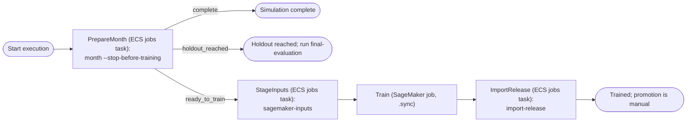

# AWS infrastructure (Terraform)

Terraform definitions for the AWS counterpart of the Compose stack: ECS serving and jobs, SageMaker training, managed storage and a monthly Step Functions workflow.

## What it creates

| Compose | AWS | Module |
| --- | --- | --- |
| Docker network | VPC with two public and two private subnets, one NAT gateway, an S3 gateway endpoint | `network` |
| LocalStack S3 | S3 buckets `data`, `models` (SageMaker output), `mlflow`: private, encrypted, versioned, TLS-only | `storage` |
| Locally built images | ECR repositories `ingestion`, `training`, `serving` with immutable tags and scanning | `storage` |
| PostgreSQL container | RDS PostgreSQL 17 hosting the source, platform, and MLflow databases; one connection-URL secret per role | `database` |
| `./state` bind mount | EFS access point mounted at `/state`: read-write for jobs, read-only for the API | `compute` |
| `api` service | ECS Fargate service behind a public Application Load Balancer; `/metrics` answers 404 publicly | `compute` |
| `mlflow` service | Internal ECS service at `http://mlflow.<name>.internal:5000` | `compute` |
| `data-jobs`, `source-loader`, `jobs`, `db-provision` | ECS task definitions `ingestion`, `seed`, `jobs`, `db-provision` for one-off commands | `compute` |
| `make month` | Step Functions workflow: prepare the month in ECS, train on SageMaker, import the release | `workflow` |
| — | EventBridge Scheduler schedule for the workflow, disabled by default | `workflow` |
| Prometheus and Grafana | CloudWatch alarms on the load balancer: p95 latency and the share of 5xx responses | `compute` |

Every container runs as uid 1000 with a read-only root file system and gets connection strings only from Secrets Manager.

## The month workflow



- **PrepareMonth** runs the same coordinator as `make month`, with its guards: it refuses to start while a recommended promotion is pending, and resumes a snapshot that has no completed cycle instead of advancing. It returns the snapshot to train through the Step Functions task token. At the first snapshot that reaches the reserved holdout it returns `holdout_reached` and the execution ends; run the `jobs` task with `final-evaluation` once, after the champion's rollout is confirmed.
- **StageInputs** writes the job's channels to the data bucket and returns them as `InputDataConfig`.
- **Train** runs the `<tag>-sagemaker` image inside the VPC so it reaches MLflow. Training job names are unique forever, so the name includes the redrive and retry counts.
- **ImportRelease** verifies the job's `model.tar.gz` and adds the release and cycle report to EFS, where `promote` and the next month find them.

Recover a failed execution with Step Functions *redrive*, which resumes at the failed state. A second start while a month is still training does not advance the simulation again: PrepareMonth resumes the same snapshot, and SageMaker refuses the repeated job name. The schedule never retries a start for the same reason.

An ECS task that stops without reporting its result fails its state only after the state's timeout (6 hours for PrepareMonth, 1 hour for StageInputs).

## Design decisions

- **Shared state on EFS.** Releases, `deployment.json`, and cycle reports stay files, so the application code is the same as in Compose. Only the jobs role may write; the API role may only mount. Loading releases from S3 and keeping deployment state in PostgreSQL would remove the file system later.
- **Scratch on task storage.** `WORK_DIR=/tmp/work` keeps DuckDB scratch files off EFS.
- **One NAT gateway** keeps cost down; losing its zone stops private egress until it returns.
- **No public MLflow.** MLflow listens only inside the VPC. No bastion or VPN is defined, so viewing its UI needs one, or ECS Exec with port forwarding (not enabled).
- **Generated role passwords are in the Terraform state.** Keep state in an encrypted, access-controlled backend. The RDS-managed master secret rotates; application passwords do not.
- **Skipped checkov checks** are listed with their reasons in [.checkov.yaml](.checkov.yaml): customer-managed KMS keys, WAF, flow and access logs, cross-region replication, and similar cost or scope choices.

## Verification

From the repository root, `make infra-check` runs Terraform formatting and validation, mocked-provider tests, tflint and checkov. CI runs the same checks without AWS credentials.

- `terraform fmt -check`, `terraform init -lockfile=readonly`, and `terraform validate`.
- `terraform test`: 20 runs across five files with mocked providers. They assert private, encrypted, TLS-only storage; the API's read-only state mount and its lack of AWS permissions; secrets-only credentials; security-group sources; the hidden `/metrics` path; HTTPS redirects; the workflow's states, commands, and retry policy; least-privilege IAM; and variable validation. Deliberately breaking a mount, a bucket's public-access block, or the schedule's retry policy makes them fail.
- tflint with the AWS ruleset, and checkov. Accepted checkov findings and their reasons are in [.checkov.yaml](.checkov.yaml).

Also checked locally, outside `make infra-check`:

- `provision.sql`, run twice with the task's exact shell command by a non-superuser holding only `CREATEROLE` and `CREATEDB` on PostgreSQL 17.6, the closest local stand-in for the RDS master user. Afterwards the application created its schema with the generated roles, `source_reader` could read but not write tables that `source_app` created later, `platform_app` could not connect to the source database, and the second run had replaced every password.
- The ingestion, training, and serving images start as uid 1000 with a read-only root file system and a writable `/tmp`: the API and MLflow pass `/health`, and the jobs and ingestion CLIs run.

## Deploying

A deployment runs continuously billed resources: the NAT gateway, load balancer, RDS instance, two Fargate services, EFS, and Container Insights, roughly 200 USD per month before data transfer and training jobs. Check the AWS pricing calculator for your region, and destroy it when you are done.

1. **Configure.** Copy `terraform.tfvars.example` to `terraform.tfvars` and set `account_id`, `image_tag` (the Git commit), and optionally the region, zones, and `api_certificate_arn`. For shared state, add an S3 backend with `use_lockfile = true`.
2. **Create the repositories first:** `terraform apply -target=module.storage`.
3. **Build and push images** for x86_64, tagged with `image_tag`:

   ```sh
   TAG=$(git rev-parse --short HEAD)
   REGISTRY=<account>.dkr.ecr.<region>.amazonaws.com
   aws ecr get-login-password | docker login --username AWS --password-stdin "$REGISTRY"
   for target in ingestion serving training; do
     docker buildx build --platform linux/amd64 --target "$target" \
       -t "$REGISTRY/fraud-dev/$target:$TAG" --push .
   done
   docker buildx build --platform linux/amd64 --target training-sagemaker \
     -t "$REGISTRY/fraud-dev/training:$TAG-sagemaker" --push .
   ```

4. **Apply everything:** `terraform apply`. The API and MLflow services start; the API reports not ready until a release is deployed.
5. **Run one-off tasks** with the outputs `cluster_arn`, `task_definition_arns`, and `run_task_network_configuration`:

   ```sh
   aws ecs run-task --cluster <cluster_arn> --launch-type FARGATE \
     --task-definition <task_definition_arns.seed> \
     --network-configuration '<run_task_network_configuration>' \
     --overrides '{"containerOverrides":[{"name":"seed","command":["seed-source","--raw-dir","/tmp/raw"]}]}'
   ```

   In order: `db-provision` (default command), `seed` with `init-db` (default) and then `seed-source --raw-dir /tmp/raw`, and `ingestion` with `initial-snapshot`.
6. **Train the initial model:** `aws stepfunctions start-execution --state-machine-arn <state_machine_arn>`. The initial snapshot has no cycle, so PrepareMonth resumes at training.
7. **Promote**, as an operator: run the `jobs` task with `promote --release <id> --initial --reason "..."`, then `aws ecs update-service --cluster <cluster> --service api --force-new-deployment`, then the `jobs` task with `verify-deployment`. It checks the API at its internal address. If the API does not serve the new release, it selects the last confirmed release again; force another deployment so the API loads it. The load balancer checks `/health`, which passes without a release, so ECS alone does not catch a release that fails to load.
8. **Each further month:** start another execution, or set `month_schedule_enabled = true`.

To destroy: set `deletion_protection = false` and apply, empty the buckets and repositories (neither is force-deleted), then `terraform destroy`.
